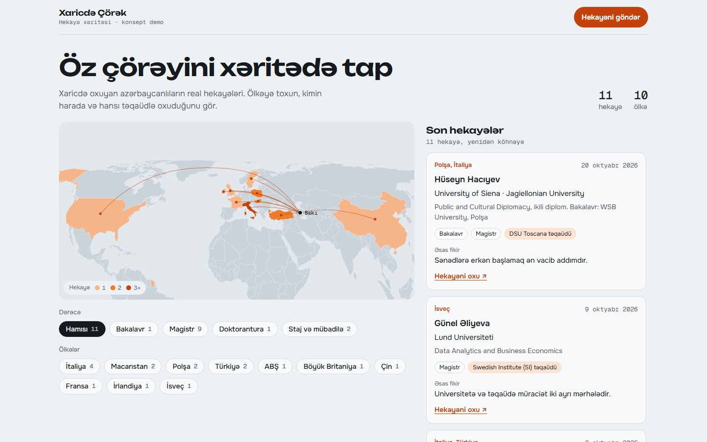

# Çörək Xəritəsi

Xaricdə Çörək üçün konsept demo: xaricdə oxuyan azərbaycanlıların hekayələri ölkələr üzrə interaktiv xəritədə.

Canlı: https://hemidhesenli.github.io/xaricde-corek-xerite/

## Nə edir

- Hekayəsi olan ölkələr hekayə sayına görə rənglənir, Bakıdan hər ölkəyə marşrut çəkilir.
- Ölkəyə toxunanda xəritə yaxınlaşır və həmin ölkənin hekayələri açılır: universitet, ixtisas, təqaüd, əsas fikir və orijinal posta link.
- Dərəcə filtri: bakalavr, magistr, doktorantura, staj və mübadilə.
- Əvvəlcə telefon üçün qurulub (Instagram bio linki), işıqlı və qaranlıq rejimi var.

## Necə qurulub

- Tək `index.html`, build addımı yoxdur.
- Xəritə: D3 (d3-geo, Equal Earth proyeksiyası) və TopoJSON. Dünya məlumatı `world-atlas` 110m faylından səhifəyə daxil edilib.
- Hekayələr [@xaricdechorek](https://www.instagram.com/xaricdechorek/) səhifəsindəki 11 açıq paylaşımdan Apify ilə toplanıb və qısaldılıb. "Əsas fikir" sətirləri xülasədir, sitat deyil.
- Şriftlər (Unbounded, Onest, Geist Mono) Azərbaycan hərflərinə, xüsusilə **ə** hərfinə görə yoxlanıb.

Bu, müstəqil konsept işdir, Xaricdə Çörək-ün rəsmi səhifəsi deyil.
